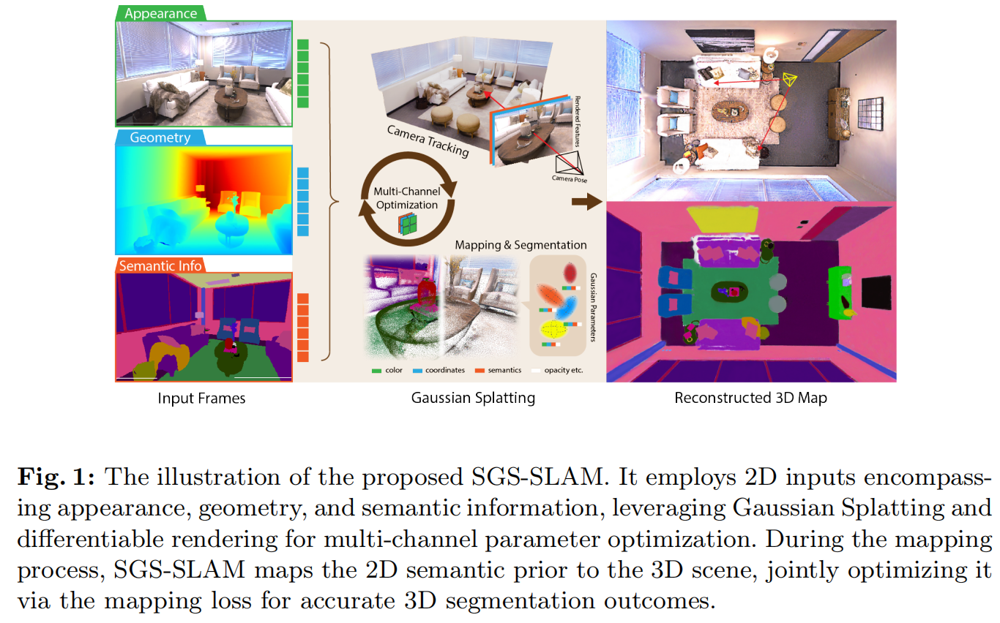

`SGS-SLAM` 方法在高斯SLAM上增加了语义信息。该系统通过多通道优化融合了外观、几何和语义特征，解决了神经隐式SLAM系统在高保真渲染、场景理解和物体级几何重建中的过度平滑问题。

该方法中，通过引入语义特征损失函数，有效弥补了传统深度和颜色损失在物体优化中的不足；通过语义引导的关键帧选择策略，避免了累积误差导致的错误重建。

该方法的主要贡献可以总结如下：

- **首创高斯语义SLAM系统**：提出首个基于3D高斯的语义RGB-D SLAM系统SGS-SLAM。该系统采用显式体积表征，实现高速实时相机追踪与场景建图。突破性地将2D语义映射转化为高斯表征的3D语义信息，相较以往NeRF方法导致的物体边缘过平滑问题，SGS-SLAM提供高保真重建与最优分割精度。

- **语义驱动的优化框架**：在SGS-SLAM中，语义地图为参数优化与关键帧选择提供额外监督。我们采用多通道参数优化策略，使外观、几何与语义信号协同优化相机追踪与场景重建。系统在追踪阶段利用这些多模态通道进行关键帧筛选，重点识别运动轨迹中的历史物体。

- **可解耦的物体操作基础**：通过语义映射，SGS-SLAM在3D场景中提供高精度可解耦物体表征，为场景编辑等下游任务奠定基础。该系统支持通过指定物体语义标签对高斯基元分组，实现物体的动态位移、旋转与移除操作。

## 方法

SGS-SLAM是一种基于高斯模型的语义视觉SLAM系统。接下来将介绍其面向联合参数优化的多通道高斯表征方法（包括跟踪与建图）和在下游任务中的潜力。核心模块展示如下：

### 多通道高斯表征

场景通过高斯影响函数 $f(\cdot)$ 进行建模。采用各向同性高斯分布简化形式：
$$
f^{\rm 3D}(x) = \sigma \exp \left(-\frac{\|x - \mu\|^2}{2r^2}\right)
$$

其中 $\sigma \in [0,1]$ 表示透明度，$\mu \in \mathbb{R}^3$ 为中心位置，$r$ 为半径。每个高斯基元附带RGB色彩向量 $\mathbf{c}_i = [r_i\ b_i\ g_i]^T $。
为实现可微分渲染，将3D高斯投影至2D图像平面：

$$
\mu^{\rm 2D} = K \frac{E_t \mu}{d}, \quad r^{\rm 2D} = \frac{lr}{d}, \quad d = (E_t \mu)_z
$$

其中 $K$ 为相机内参，$E_t$ 表示 $t$ 帧相机外参，$l$ 为焦距。通过深度排序和体渲染计算像素色彩：
$$
C_{\rm pix} = \sum_{i=1}^n c_i f_{i,\rm pix}^{\rm 2D} \prod_{j=1}^{i-1}(1-f_{j,\rm pix}^{\rm 2D})
$$

同理可得深度渲染公式：

$$
D_{\rm pix} = \sum_{i=1}^n d_i f_{i,\rm pix}^{\rm 2D} \prod_{j=1}^{i-1}(1-f_{j,\rm pix}^{\rm 2D})
$$

令$d_i=1$可生成可见性掩膜$Sil_{\rm pix} = D_{\rm pix}(d_i=1)$，用于相机位姿估计和新基元生成。
语义地图渲染公式：

$$
S_{\rm pix} = \sum_{i=1}^n s_i f_{i,\rm pix}^{\rm 2D} \prod_{j=1}^{i-1}(1-f_{j,\rm pix}^{\rm 2D})
$$

其中 $\mathbf{s}_i = [r_i\ b_i\ g_i]^T$ 为语义色彩向量，在映射过程中与表观颜色和深度联合优化。

### 追踪与建图

#### 相机位姿估计

首帧相机位姿设为世界坐标系原点，后续帧位姿通过恒速模型初始化：$E_{t+1} = E_t + (E_t - E_{t-1})$ ，通过最小化渲染结果与真实观测之间的差异迭代优化位姿：
$$
\mathcal{L}_{\rm tracking} = \sum_{\rm pix} (Sil_{\rm pix} > T_{\rm sil})(\lambda_D |D_{\rm pix}^{GT} - D_{\rm pix}| + \lambda_C |C_{\rm pix}^{GT} - C_{\rm pix}| + \lambda_S |S_{\rm pix}^{GT} - S_{\rm pix}|)
$$

其中 $T_{\rm sil}$ 为可见性掩膜阈值，仅对高确定性可见像素计算损失。

#### 关键帧选择与加权

采用两级筛选机制：

- 几何约束筛选：

    $$
    \eta = \frac{1}{\sum G_{\rm proj}} \sum_{n=i} \{G_i | 0 \leq {\rm width}(G_i) \leq W, 0 \leq {\rm height}(G_i) \leq H\}
    $$

    剔除投影占比 $\eta < T_{\rm geo}$ 的关键帧

- 语义约束筛选：
剔除与当前帧语义交并比(mIoU)过高($>T_{\rm sem}$)的关键帧
关键帧不确定性权重：
$$
U(t) = e^{-\tau t}
$$

- 场景重建
  三维场景通过三通道高斯参数表征：

  - 几何通道：中心坐标 $\mu$
  - 外观通道：RGB颜色 $\mathbf{c}_i$
  - 语义通道：语义颜色 $\mathbf{s}_i$

  新增高斯基元的条件：

  - 可见性不确定性高：$Sil_{\rm pix} < T_{\rm vis}$
  - 存在新几何：$D_{\rm pix}^{GT} \ll D_{\rm pix}$

  映射损失函数：

  $$
\mathcal{L}_{\rm mapping} = \mathcal{U}_t \sum_{\rm pix} \lambda_D |D_{\rm pix}^{GT} - D_{\rm pix}| + \lambda_C \mathcal{L}_C + \lambda_S \mathcal{L}_S
  $$

  加权SSIM损失：

  $$
\mathcal{L}(I_{\rm pix}) = \sum_{\rm pix} \alpha |I_{\rm pix}^{GT} - I_{\rm pix}| + (1-\alpha)(1 - {\rm ssim}(I_{\rm pix}^{GT}, I_{\rm pix}))
  $$

**技术优势**

- 相比NeRF类方法：显式高斯表征实现实时渲染
- 相比传统高斯方法：多通道联合优化提升重建与分割效率
- 通过语义-几何耦合优化有效解决NeRF的过平滑问题

### 基于物体几何的场景编辑

由于场景采用显式高斯表征，我们可以直接对特定语义类别的高斯基元组进行操作。这些高斯群组在重建过程中通过式(1)定义，支持以下编辑方式：

$$
f^{\rm 3D}_{\rm edit}(G, \tilde{y}) = M(G, \tilde{y}) \cdot \Phi_T(f^{\rm 3D}(G), \tilde{y})
$$

式中参数说明：

- $M(G,\tilde{y})$：可见性掩膜，根据语义标签$\tilde{y}$决定保留(1)或移除(0)高斯基元
- $\Phi_T(f^{\rm 3D}(G), \tilde{y})$：空间变换函数，对选定语义类别的高斯进行坐标转换

主要编辑能力包括：

- 选择性保留：通过二值掩膜实现物体删除/保留
- 空间变换：对特定语义物体进行平移/旋转/缩放操作
- 语义级联：保持相同语义标签物体的几何一致性

注：

- 编辑操作保持可微分特性，支持梯度反向传播
- 所有变换均在3D空间执行，保证多视角一致性
- 通过语义标签$\tilde{y}$实现物体级别的精确控制

## 总结与思考：语义、几何与“伪语义”的博弈

1. **语义是约束，而非仅仅是结果**
SGS-SLAM 的核心价值在于它重新定义了语义信息在 SLAM 流程中的角色。在过去，语义往往是建图的“副产品”；而在本作中，语义成为了与 RGB、深度并行的第三种基础约束。
通过将语义标签 $s_i$ 注入高斯基元，系统在追踪阶段利用语义一致性（Semantic Consistency）来弥补光度误差（RGB Loss）的先天不足。这种“多模态联合优化”的范式，使得模型在面对弱纹理、强反光等传统视觉 SLAM 的“死穴”时，能够凭借物体的空间连续性强行拉回位姿精度。

2. **关于“伪语义”的深度定性**
尽管 SGS-SLAM 表现出色，但从本质上审视，它依然是一套高度依赖外部先验的“映射系统”：

   - **属性堆砌而非理解**：它通过将语义映射为高斯球的一个属性通道，实现了一套极其高效的插值逻辑。正如我在笔记中所述，这本质上是“伪语义”——系统并没有真正理解物体的类属关系，它只是给每一个 3D 高斯基元涂上了一层名为“标签”的色彩。
   - **先验的奴隶**：系统的上限完全取决于输入的 2D 语义图精度。它更像是一个“3D 语义复印机”，而非具有感知能力的智能体。

3. **反思与思考**
   如果硬要给该文章下一个定论，该方法并没有实现本质上改进：仍旧是一篇引入先验数据提升指标的灌水文，这种文章还是只能说明：在当前的技术道路上还可以进行哪些应用性或工程性的改进。但是功利的来说，为了发论文，这种论文恰恰是需要的——加入一些先验数据、改动一些模块和优化方法即可获得一个SOTA指标，发表论文，然后毕业工作美滋滋😊。

